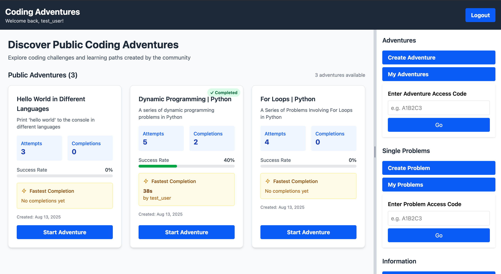
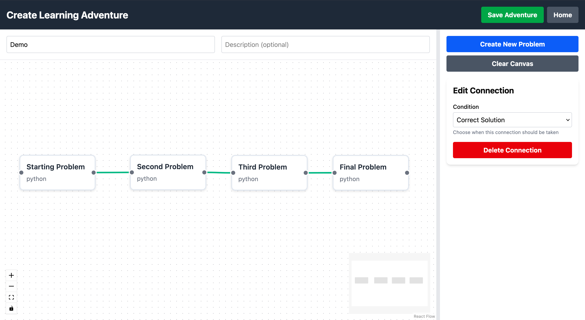
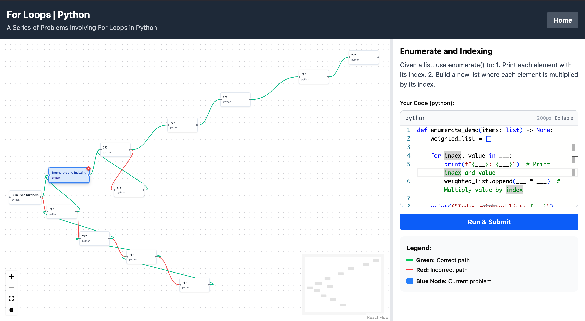
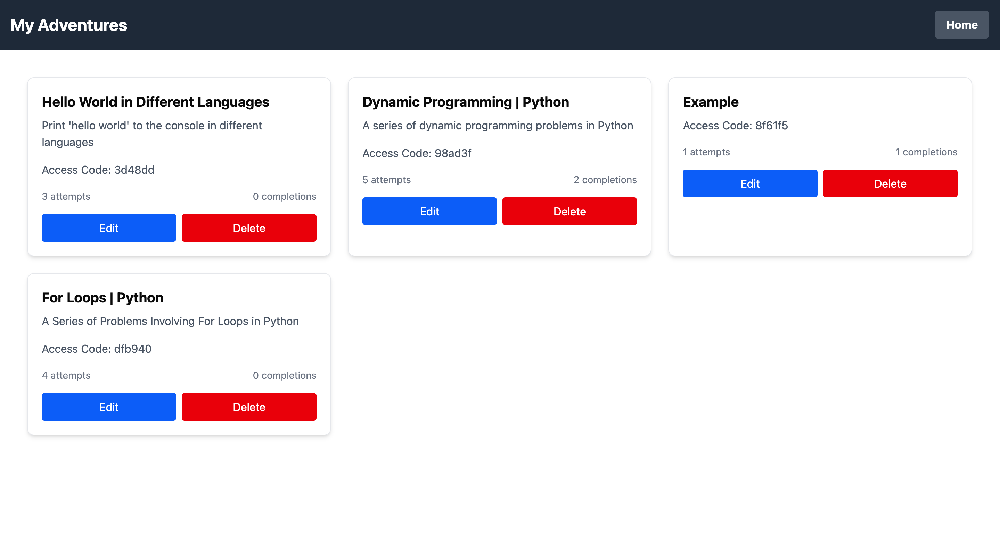

# **Adventure Code**

A web-based platform for creating and sharing coding adventures - promoting active learning through gamification and adaptive problem sequences. 

## **Overview**

Adventure Code is an educational platform that enables educators and students to create "coding adventures" - sequences of programming problems represented as interactive graphs. Each node represents a coding problem, and edges determine the path through the adventure based on whether problems are solved correctly or incorrectly. This approach facilitates adaptive learning experiences that can adjust difficulty dynamically based on performance. 

## **UI**

### **Home Page**

### **Create Adventure**

### **Attempt Adventure**

### **My Adventures**

## **Key Features**

- **Interactive Adventure Creation**: Build coding adventures using a visual graph interface
- **Adaptive Problem Sequences**: Create branching paths based on correct/incorrect solutions
- **Secure Code Execution**: Safe execution of user code using containerised sandboxing (Piston engine)
- **Multi-language support**: Adventure Code supports Python, JavaScript, TypeScript, Java, C++, C, Go, Rust, PHP, Ruby, and Bash.
- **Guest Mode**: Attempt adventures without account creation
- **Progress Tracking**: Save progress for registered users
- **Leaderboard System**: Gamification through fastest completion times
- **Sharable Adventures**: Generate unique 6-digit access codes for easy sharing of adventures.

## **Architecture**

Adventure Code follows a 3-tier architecture

- **Frontend**: React with TypeScript, Vite, React Flow, and TailwindCSS
- **Backend**: FastAPI with Python
- **Database**: PostgreSQL 

## **How to Run Locally**

Prerequisite: Must have Docker downloaded and running on your machine.

1. Clone the repository: run `git clone https://github.com/Joshua-Onley/AdventureCode`

2. `cd` into the project directory

3. run `docker-compose up --build -d`

4. open a web-browser and go to http://localhost:5173

